# HackerVerse Sept 2026 - Digital Forensics CTF Writeup

**Mohammad Thabet Hassan** · 30 September 2026

**Result: 2000 / 2000 across all 27 challenges** · EC-Council certificate level: **Grandmaster**

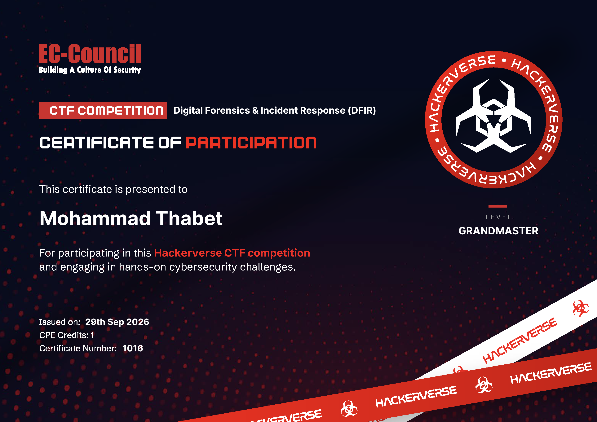

A PDF version of this writeup is in this repository: [HackerVerse-DFIR-Sept-2026-writeup.pdf](HackerVerse-DFIR-Sept-2026-writeup.pdf).

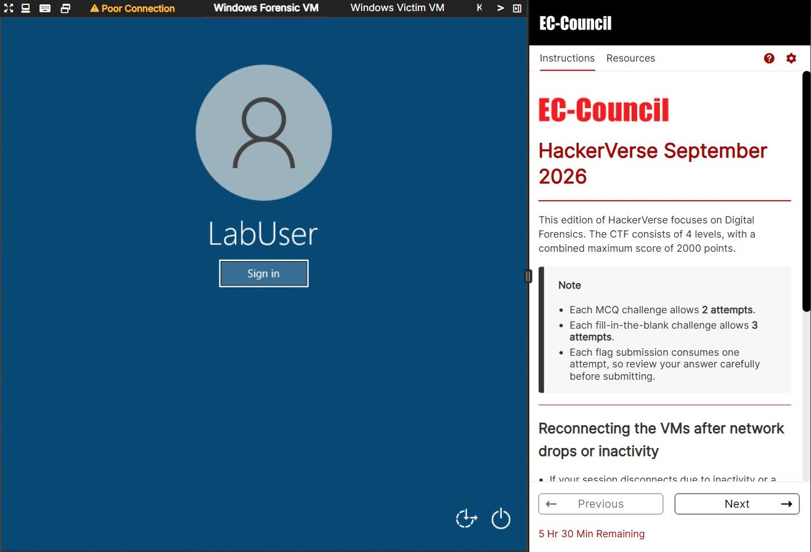

*The live EC-Council lab - Windows Forensic VM, Windows Victim VM and Kali Linux (left), with the HackerVerse instructions panel: Digital Forensics, 4 levels, 2000 points.*

## Overview

**Scenario.** A simulated intrusion staged across four separate evidence sets - a media dump, a full packet capture, a compromised Windows host (memory + disk), and a malware sample pulled off that host. Each level is one stage of the same story: how the attacker hid data, moved across the network, stole stored credentials, and finally detonated ransomware - and how every step is reconstructed from the artifacts left behind.

**Approach.** Each level follows the same discipline: *identify the carrier or artifact, understand the scheme protecting the secret, then reverse exactly that scheme* - no guessing, and no brute force where structure will do the work.

**Environment & tooling.** Kali Linux for analysis, a Windows victim host, and the supplied evidence VMs. Primary tools: `xxd` / a hex editor, `steghide`, Audacity and CyberChef for the media and encoding work; `tshark` / Wireshark for the capture; `pypykatz` and Python's `cryptography` for the credential recovery; Detect It Easy, `de4dot`, and dnSpy for the malware.

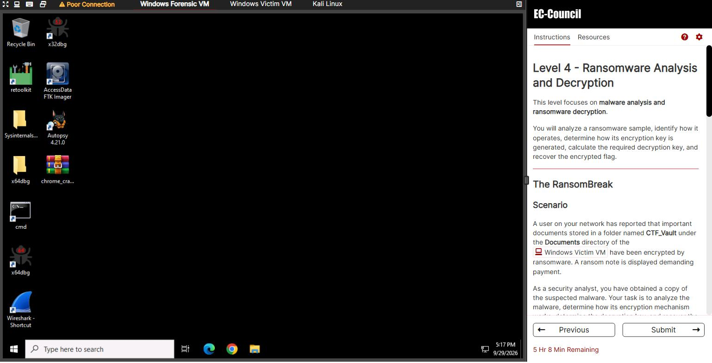

*The analysis workstation (Windows Forensic VM): x64dbg / x32dbg, retoolkit, FTK Imager, Autopsy, Sysinternals and Wireshark - the toolkit used across the four levels.*

| Level | Focus | Core technique | Flag |
| --- | --- | --- | --- |
| 1 | Steganography & data hiding | Audio/binary decode, JFIF carving, `steghide`, layered-encoding unwrap | `FLAG{ViCtOrYaChIeVeD}` |
| 2 | Network forensics | Protocol hierarchy -> stream reconstruction -> LFI & C2 attribution | `flag{A1EL2L8P}` |
| 3 | Credential forensics | LSASS/DPAPI master key -> Chrome AES key -> `Login Data` decrypt | recovered credential |
| 4 | Malware RE & recovery | MPRESS unpack -> dnSpy -> rebuild AES key -> decrypt files | `flag{b4CKup_SaV3D_7h3_$YsTeM}` |

**Result: 2000 / 2000 - all 27 challenges.** Skills exercised end to end: steganography and multi-layer decoding, packet analysis and intrusion reconstruction, Windows secrets/DPAPI internals, and .NET malware reverse engineering with practical file recovery.

### How to read this report

Each level follows the shape a working forensic analyst uses: **Scenario** (what happened) -> **Method & tools** (how it was investigated) -> **Evidence** (the exact commands and their output) -> **Recovery** (the flag or answer) -> **Defensive note** (how to stop it). Every level also opens with an *In plain English* line, so a non-technical reader can follow the story while a technical reader gets the full commands, values, and diagrams.

## Level 1 - Cryptic Canvas (steganography)

**Objective ("Cryptic Canvas").** The level hides fragments in media across three artefacts: *The Hidden Voice* - an `Audio.wav` clip on Kali at `/root/Stego Artifacts` carrying a Morse message; a JPEG with a `steghide`-embedded payload; and *Camouflage* - `Encoded_Dump.txt` at `/root/Encoded Artifact`, five Base64-looking strings salted with decoys and hints around one genuine secret. The skill is *carrier identification* - knowing what a file really carries before trying to read it.

*In plain English:* the clues are tucked inside an audio file, an image, and a block of scrambled text. Each one is opened with the right tool, like a set of nested boxes.

### 1.1 · The Hidden Voice (Audio.wav)

Opened in Audacity, `Audio.wav` is neither speech nor music but a train of short and long tones separated by gaps - Morse code. Reading the dots, dashes and spaces back through the Morse table spells out the flag:

`flag{binary_audio_secrets}`

*Tooling:* import the WAV into Audacity to read the tone timing (or feed it to a CW / Morse decoder), then map dot-dash to letters. The flag's wording - `binary_audio_secrets` - is a deliberate red herring: the carrier is Morse, not raw binary.

### 1.2 · File signature of the recovered image

Confirm what the file actually is before opening it - the extension can lie, the magic bytes cannot:

```text
$ file Audio.wav Cat.jpg
Audio.wav: RIFF (little-endian) data, WAVE audio, Microsoft PCM, 8 bit, mono 11050 Hz
Cat.jpg:   data

$ xxd -l 48 Cat.jpg
00000000: 00d8 ffe0 0010 4a46 4946 0001 0100 0001  ......JFIF.. ..
```

The extension says JPEG, but `file` reports plain `data` - the very first byte was zeroed. The hex confirms it: `00 D8 FF E0`, where a valid JPEG must begin `FF D8 FF E0` (`FF D8` = Start-of-Image, `FF E0` = the APP0 / JFIF segment, visible as `JFIF` at offset 6). Restoring byte 0 to `FF` repairs the image. Answer: **`FF D8 FF E0`**.

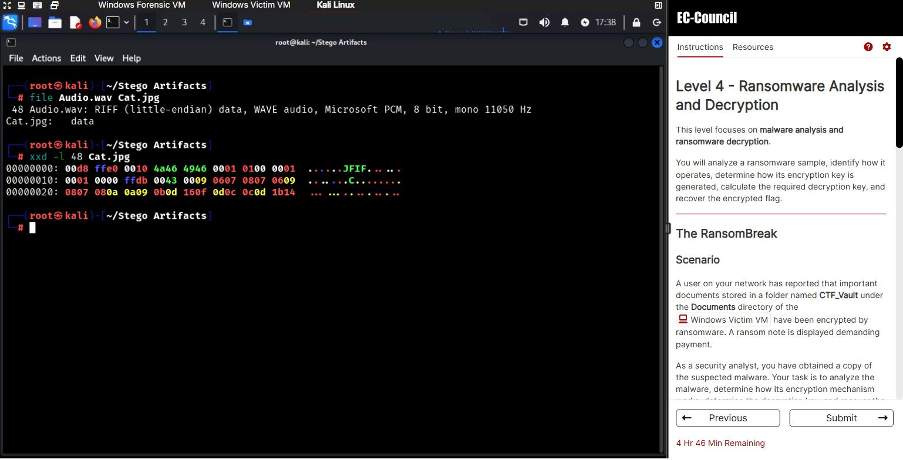

*Kali (`~/Stego Artifacts`): `file` flags `Cat.jpg` as plain `data`, and `xxd` shows why - the header reads `00 D8 FF E0` instead of `FF D8 FF E0`, with `JFIF` still legible at offset 6.*

### 1.3 · Payload hidden in the image

The image from 1.2 is still broken, so it is repaired first: copy the valid `FF` byte from offset 2 over the zeroed byte 0 with `dd`, then treat the restored file as a `steghide` carrier. The extracted payload is itself Base64, so one more decode gives the flag:

```text
$ cp Cat.jpg fix.jpg
$ dd if=Cat.jpg of=fix.jpg bs=1 skip=2 seek=0 count=1 conv=notrunc
1 byte copied   (the FF at offset 2 overwrites the zeroed byte 0)
$ xxd -l 4 fix.jpg
00000000: ffd8 ffe0                                 ....
$ steghide extract -sf fix.jpg      (empty passphrase)
wrote extracted data to "flag.txt".
$ base64 -d flag.txt
CTF{steg0_1s_co0l}
```

Flag: **`CTF{steg0_1s_co0l}`**.

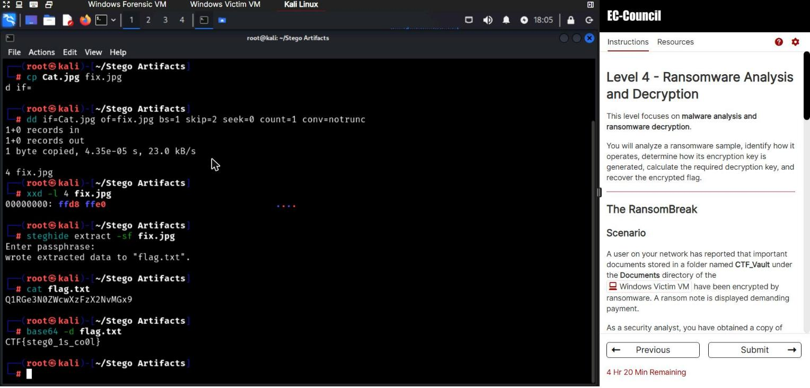

*The full image solve on Kali: `dd` restores the `FF D8 FF E0` header, `steghide extract` (empty passphrase) writes `flag.txt`, and `base64 -d` reveals **`CTF{steg0_1s_co0l}`** - the actual flag, recovered live.*

### 1.4 · Reading the encoding chain

The final payload is a string run through several encoders. Each layer leaves a fingerprint, so the stack can be read top-down before a single byte is decoded:

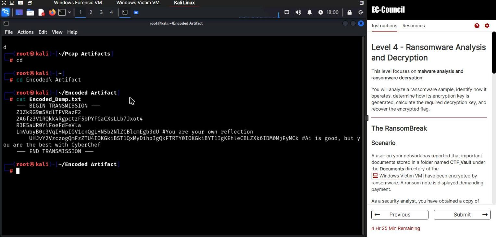

*`Encoded_Dump.txt` (Kali, `~/Encoded Artifact`): five encoded strings salted with planted hints. The long Base64 hint decodes to "Process: Base58 -> ROT13 -> ..." with a hex XOR key - the challenge literally hands over the decode order, which is the answer to the Level 1 MCQ.*

- **Base58** - alphanumeric, but no `0` / `O` / `I` / `l` and no `=` padding (the Bitcoin alphabet).
- **ROT13** - output is still readable Latin text, only letter-shifted.
- **Base64** - `A-Za-z0-9+/` with `=` padding.
- **XOR** - output is high-entropy, non-printable bytes.

Identified sequence: **Base58 -> ROT13 -> Base64 -> XOR**. Decoding runs it in reverse.

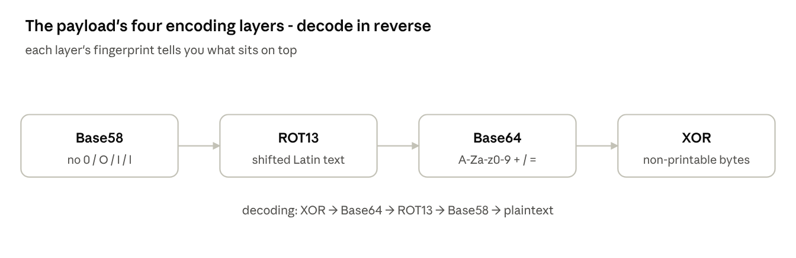

### 1.5 · Level 1 flag

Unwinding the chain - recover the XOR key, then Base64-decode, ROT13, and Base58-decode - reveals the plaintext:

`FLAG{ViCtOrYaChIeVeD}`

CyberChef collapses this into a single recipe; the skill on display is *reading the layers*, not running the decoder.

## Level 2 - Network Intrusion Forensics

**Objective ("ChatOps Breached").** Synixon Technologies' new ChatOps collaboration platform was breached within days of launch; the SOC flagged password resets with no user approval, rogue account creation, and repeated suspicious API calls. A single packet capture holds the whole intrusion - phishing, web exploitation, WebSocket chat abuse, and command-and-control. The method never changes: *map the protocols first, then follow only the streams that matter.*

*In plain English:* the company's team-chat app was hacked; the entire attack was captured as network traffic, and this level rebuilds exactly what the attacker did, in order, from that recording.

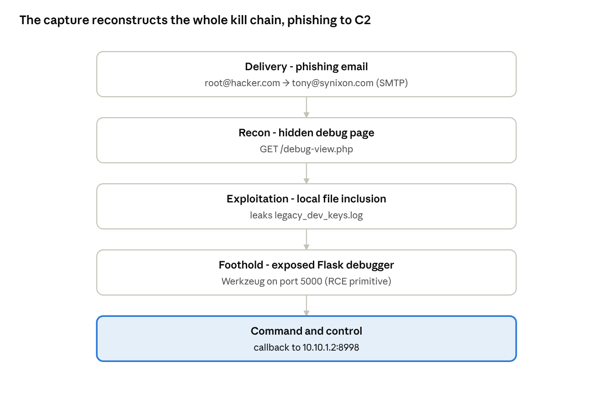

Every hop above is one followed stream in the capture - the sections below are the tooling for each.

### 2.1 · Map the capture

Don't start by scrolling packets. Pull the protocol hierarchy, then enumerate every HTTP request in one pass:

```bash
# What protocols are present, and their byte share
tshark -r capture.pcapng -q -z io,phs

# Every URL touched: source, host, method, path - in order
tshark -r capture.pcapng -Y http.request \
  -T fields -e ip.src -e http.host -e http.request.method -e http.request.uri
```

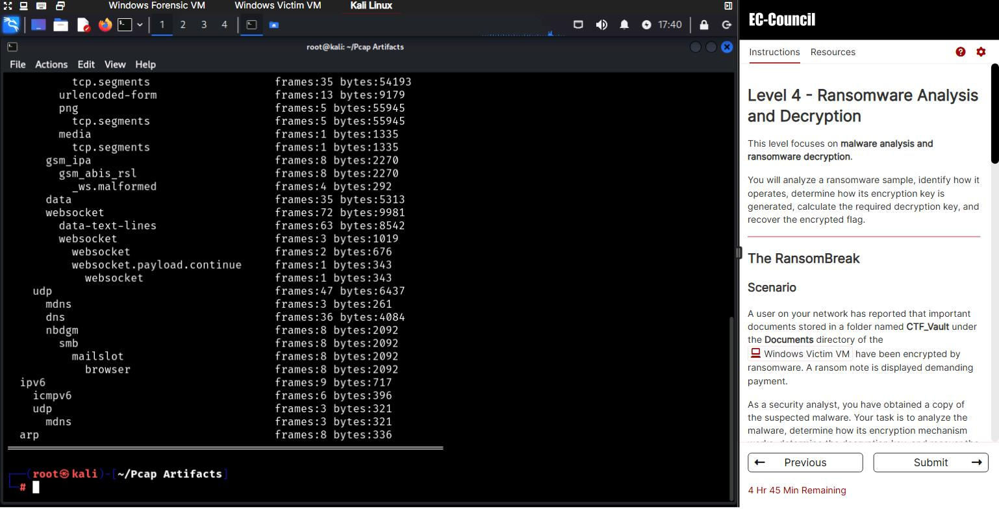

*`tshark -q -z io,phs` on `synixon_breach_capture.pcapng` (Kali): the protocol breakdown, including the **WebSocket** traffic (72 frames) the attacker abused for the ChatOps password resets, alongside the HTTP form posts and file transfers.*

That request list is the map for everything below; the renamed pages and the LFI only stand out once they are all in front of you.

### 2.2 · The phishing thread

Isolating the mail traffic (`-Y smtp`, then *Follow TCP Stream* on the SMTP conversation) gives both ends of the lure, plus a second attacker address that reappears later in the web traffic:

- Attacker sender: **`root@hacker.com`**
- Victim recipient: **`tony@synixon.com`**
- Second attacker address: **`admin@hacker.com`**

### 2.3 · Web exploitation: debug endpoint + LFI

The request list exposes a non-standard debug page and a local file inclusion pulling a sensitive log. A quick filter for traversal / debug paths:

```bash
tshark -r capture.pcapng -Y 'http.request.uri contains ".." or http.request.uri contains "debug"' \
  -T fields -e http.request.uri
```

- Hidden debug endpoint: **`debug-view.php`**
- File pulled through the LFI: **`legacy_dev_keys.log`**
- Service/port value read off the reconstructed stream: **`17645`**

### 2.4 · Obfuscated admin panel & dev server

The attacker reached a renamed admin login and a debug web server that had been left running:

- Obfuscated admin page: **`admin_login_ERHG23W2.php`**
- Werkzeug / Flask debug port: **`5000`** - the interactive debugger is a full RCE primitive whenever it is reachable.

### 2.5 · Callback and the flag

Following the final session (a WebSocket / raw TCP stream) reveals the attacker's callback endpoint and the level flag:

- C2 callback (host:port): **`10.10.1.2:8998`**
- Level 2 flag: **`flag{A1EL2L8P}`**

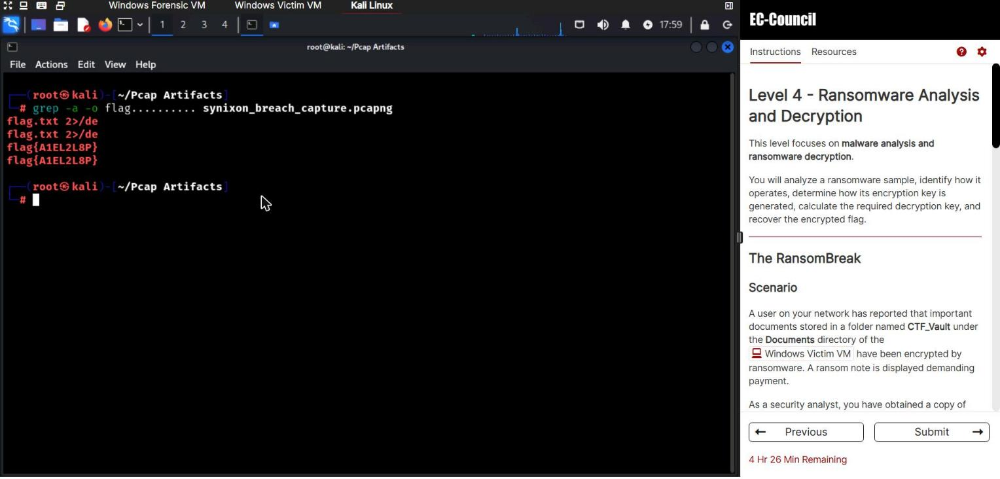

*The flag pulled straight from `synixon_breach_capture.pcapng` on Kali - `grep -a -o` surfaces **`flag{A1EL2L8P}`**. (The `flag.txt 2>/de...` hits are the attacker's own exfiltration command, also captured in the traffic.)*

| # | Question | Answer |
| --- | --- | --- |
| 1 | Attacker email | `root@hacker.com` |
| 2 | Victim email | `tony@synixon.com` |
| 3 | Hidden debug endpoint | `debug-view.php` |
| 4 | LFI target file | `legacy_dev_keys.log` |
| 5 | Second attacker email | `admin@hacker.com` |
| 6 | Service / port value | `17645` |
| 7 | Obfuscated admin page | `admin_login_ERHG23W2.php` |
| 8 | Debug server port | `5000` |
| 9 | C2 callback | `10.10.1.2:8998` |
| 10 | Level 2 flag | `flag{A1EL2L8P}` |

## Level 3 - Windows Credential Forensics

**Objective ("The ChromeCracker").** A compromised Windows host: the attacker had logged into a cryptocurrency site, `chaincrypto.com`, and the goal is to recover that saved login from two artefacts - a memory dump of the `LSASS` process and the attacker's Chrome profile. This is the *incident-response* side of credential theft: you reconstruct what was taken by understanding exactly how Windows and Chrome protect it.

*In plain English:* the attacker had a password saved in Chrome. Windows and Chrome encrypt saved passwords, so this level walks that encryption backwards - using the machine's own memory - to read the password back out.

### 3.1 · Attribution

The evidence - an LSASS process dump alongside registry/SAM artifacts - is the signature of an LSASS credential-dumping attack. The tool synonymous with that tradecraft, and the expected answer, is **Mimikatz** (`sekurlsa::logonpasswords`, `sekurlsa::dpapi`). `pypykatz` used below is simply its Python re-implementation, run for the offline parse.

The attacker's local account is enumerated straight off the host:

```text
C:\> net user

User accounts for \\WIN10
-------------------------------------------------------------
Administrator   DefaultAccount   Guest   LabUser   WDAGUtilityAccount
```

The answer format `XxxXxxx` (seven characters, capitals at positions 1 and 4) fits exactly one non-builtin account: **`LabUser`**. Lesson: a memory string tempts you toward `Admin`, but the format constraint is the stronger signal.

### 3.2 · How Chrome protects saved passwords

Since Chrome 80 the scheme is two-tier:

- A per-profile AES-256 key, generated once and written to `%LOCALAPPDATA%\Google\Chrome\User Data\Local State`, JSON field `os_crypt.encrypted_key`. That key is **DPAPI-wrapped** (prefixed with the ASCII tag `DPAPI`).
- Each saved password lives in the `Login Data` SQLite database, column `logins.password_value`, as an **AES-256-GCM** blob: 3-byte version tag `v10`, 12-byte nonce, ciphertext, 16-byte auth tag.

The recovery chain is therefore: **DPAPI master key -> unwrap the Chrome AES key -> AES-GCM-decrypt each password**. DPAPI is the only hard link, and here the master key is recoverable from the LSASS image.

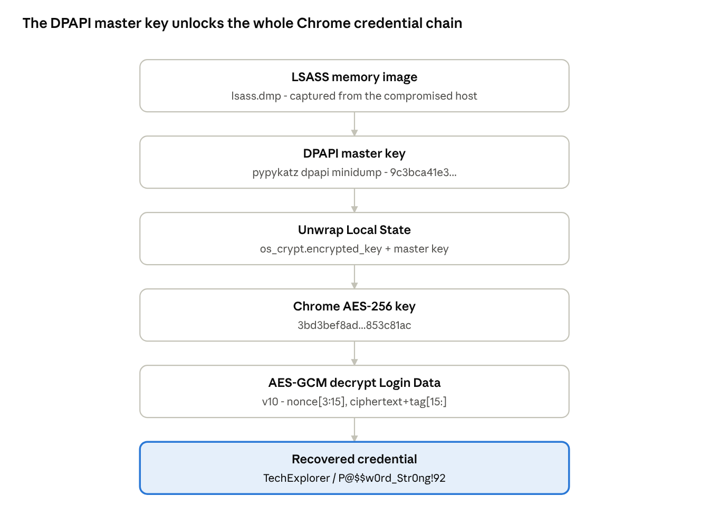

Each arrow is one reversible step; the master key at the top is the only link a hardened host would break.

### 3.3 · Recover the DPAPI master key

`pypykatz` parses the master keys out of the minidump:

```bash
pypykatz dpapi minidump lsass.dmp
# [GUID]      f7ecfe82-d268-4507-8761-3ccdbef6496b
# [MASTERKEY] 9c3bca41e3 ... 48478237e48
```

Master key (first bytes): **`9c3bca41e3`**.

### 3.4 · Unwrap the Chrome AES key

With the master key known, the DPAPI blob in `Local State` decrypts to the profile AES key. Read `os_crypt.encrypted_key`, base64-decode, strip the 5-byte `DPAPI` tag, and unwrap the remainder under the recovered master key:

```text
encrypted_key (Local State)  --base64, strip "DPAPI"-->  DPAPI blob
DPAPI blob + master key      --DPAPI unwrap-->           AES-256 key
                                                        => 3bd3bef8ad ... 853c81ac
```

Chrome AES key (first bytes): **`3bd3bef8ad`**.

### 3.5 · Decrypt the stored credential

Each `Login Data` password blob is AES-GCM, so the decrypt reduces to slicing the blob and calling one primitive: `nonce = blob[3:15]`, `ciphertext||tag = blob[15:]`, key = the AES key from 3.4.

```python
from cryptography.hazmat.primitives.ciphers.aead import AESGCM
plain = AESGCM(aes_key).decrypt(blob[3:15], blob[15:], None)
```

Recovered credential:

- Username: **`TechExplorer`**
- Password: **`P@$$w0rd_Str0ng!92`**

**Defensive note.** The chain closed only because the DPAPI master key sat in a readable LSASS image. Protect LSASS (RunAsPPL / Credential Guard) and deny the `SeDebugPrivilege` path that allows the dump, and the recovery dies at step 3.3 - the Chrome key stays sealed.

## Level 4 - Ransomware Analysis & Decryption

**Objective ("The RansomBreak").** Files in a `CTF_Vault` folder under Documents on the Windows Victim VM were encrypted by ransomware, with a ransom note left behind. Given a copy of the malware, the task is to reverse it, work out how its key is generated, rebuild that key, and decrypt the files - read-only static analysis of the sample, nothing run against a live host.

*In plain English:* a virus locked the victim's files and demanded payment. Rather than pay, we take the virus apart, find that its lock is weak, rebuild the key ourselves, and unlock the files for free.

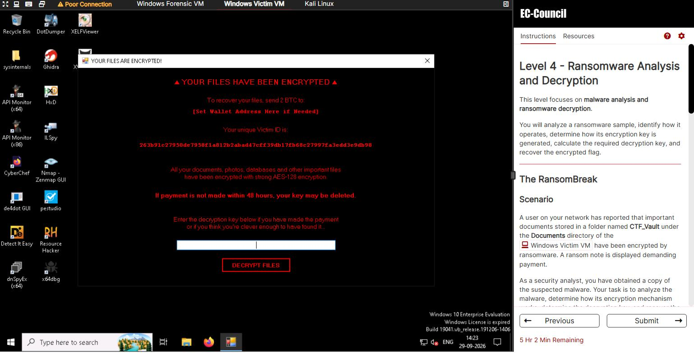

*The live ransom note on the Windows Victim VM - a 2 BTC demand, a per-victim ID, and "strong AES-128 encryption" (exactly what the analysis below rebuilds). The desktop behind it is the malware-analysis toolkit: dnSpyEx, de4dot, Detect It Easy, Ghidra and ILSpy.*

### 4.1 · Triage & identification

The dropped binary sits under the user profile:

`C:\Users\Admin\AppData\Local\Rasome\Rasome.exe`

Detect It Easy (DIE) fingerprints the runtime and the protector before any decompilation:

```text
Detect It Easy: Rasome.exe
  PE32     .NET
  Runtime: v4.0.30319
  Packer:  MPRESS
```

- .NET runtime: **`v4.0.30319`**
- Packer: **`MPRESS`**

MPRESS is a compressing packer; it has to be stripped before the IL is readable.

### 4.2 · Unpacking

MPRESS unpacks cleanly, and `de4dot` then normalises the assembly - removing packer/obfuscator scaffolding and restoring clean names - so dnSpy can decompile it:

```bash
de4dot Rasome.exe -o Rasome-clean.exe
```

### 4.3 · The key routine

Decompiled in dnSpy, the cryptography is deliberately weak: the entire key is derived from host data, with no server-side secret.

```csharp
// key = MD5( MachineName.ToUpperInvariant() )
byte[] GenerateKeyFromMachineNameMD5() {
    string m = Environment.MachineName.ToUpperInvariant();
    return MD5.Create().ComputeHash(Encoding.UTF8.GetBytes(m));
}
// IV = SHA256( fileName )[..16];  cipher = AES-128-CBC + PKCS7
```

Key-derivation method: **`GenerateKeyFromMachineNameMD5`**.

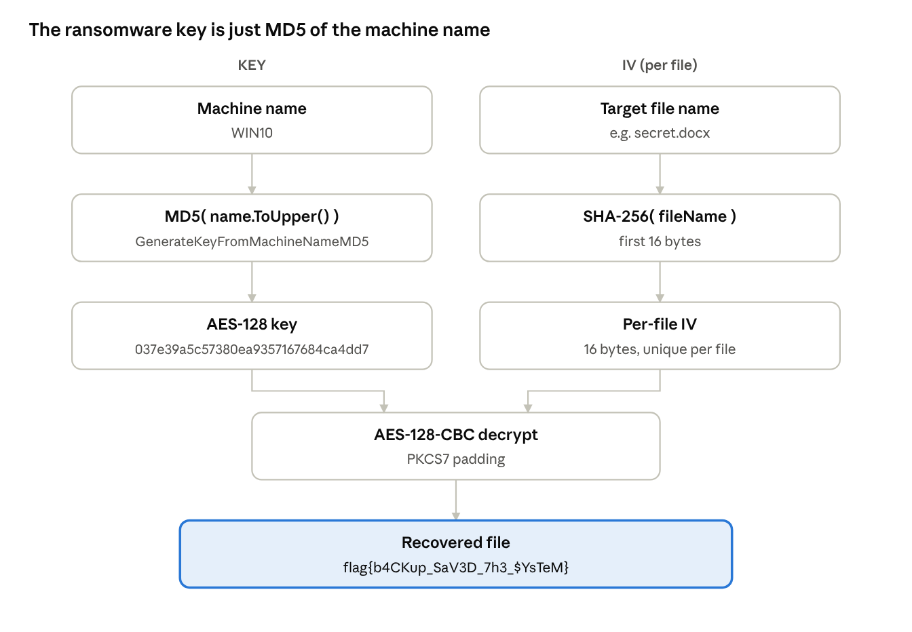

Both inputs are attacker-side constants, so the whole scheme is reproducible offline - which is exactly why the files were recoverable.

### 4.4 · Rebuild the key and recover the file

Because the key is a pure function of the machine name, an investigator recomputes it offline. The victim host is `WIN10`:

```bash
printf 'WIN10' | md5sum
# 037e39a5c57380ea9357167684ca4dd7
```

AES key: **`037e39a5c57380ea9357167684ca4dd7`**. With the key plus the per-file IV (`SHA256(filename)[:16]`), the protected file decrypts under AES-128-CBC / PKCS7, yielding the final flag:

`flag{b4CKup_SaV3D_7h3_$YsTeM}`

**Verified live.** The ransom note's Victim ID (`263b91c2...9db98`) is exactly `SHA-256("WIN10")`, which independently confirms the machine name. Entering the rebuilt key `037e39a5c57380ea9357167684ca4dd7` into the ransomware's own DECRYPT FILES prompt returned **"Decryption Finished"** and restored the `CTF_Vault` files.

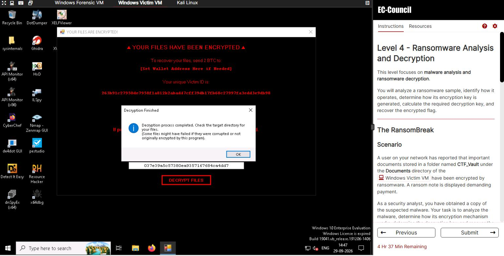

*The rebuilt key entered into the ransomware's own decryptor on the Windows Victim VM - the "Decryption Finished" dialog confirms the files were recovered, proving the key derivation end to end.*

**Why this is recoverable and real ransomware is not.** The key never left the host - it *is* the host name. Production-grade ransomware generates a random key per victim and wraps it with an attacker-held public key, so it cannot be rebuilt offline. The teaching point: a host-derived, deterministic key is a broken key.

## Tools & techniques

Every tool used across the four levels, and what each one did:

| Tool | Level | What it did |
| --- | --- | --- |
| `file`, `xxd` | 1 | File-type identification and hex inspection - spotting the zeroed JPEG signature |
| `dd` | 1 | Byte-level repair of the JPEG header (`00` -> `FF`) |
| `steghide` | 1 | Extracting the payload hidden in the image |
| Audacity + Morse decode | 1 | Reading the Morse message out of `Audio.wav` |
| `base64` / CyberChef | 1 | Unwinding the layered Base58 -> ROT13 -> Base64 -> XOR payload |
| `tshark` / Wireshark | 2 | Protocol hierarchy, HTTP and WebSocket stream reconstruction |
| `grep` | 2 | Carving the flag and network IOCs from the raw capture |
| `pypykatz` | 3 | Parsing the DPAPI master key from the LSASS memory dump |
| Python `cryptography` | 3 | AES-256-GCM decryption of Chrome's `Login Data` store |
| Detect It Easy (DIE) | 4 | Fingerprinting the packer (MPRESS) and the .NET runtime |
| `de4dot` | 4 | Unpacking and deobfuscating the .NET assembly |
| dnSpyEx | 4 | Decompiling to read `GenerateKeyFromMachineNameMD5` |
| `md5sum`, `sha256sum` | 4 | Rebuilding the AES key and verifying the Victim ID |

The Windows Forensic and Victim VMs also carry the wider DFIR / RE toolkit seen in the screenshots - FTK Imager, Autopsy, x64dbg, Ghidra, ILSpy, HxD, pestudio and Resource Hacker.

## Indicators & takeaways

The artifacts across the four levels reconstruct one kill chain: phishing -> web exploitation (LFI + an exposed debugger) -> credential theft (LSASS / DPAPI) -> ransomware. Consolidated indicators:

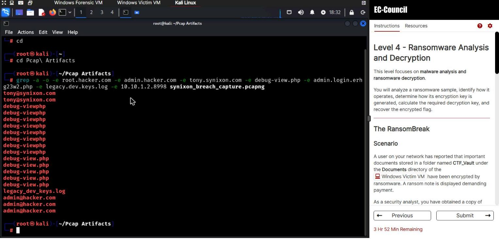

*Indicators pulled straight from `synixon_breach_capture.pcapng` with `grep -a -o` on Kali - the phishing addresses (`tony@synixon.com`, `admin@hacker.com`), the LFI-vulnerable `debug-view.php`, and the leaked `legacy_dev_keys.log`, lifted from the raw traffic.*

| Type | Indicator | Source |
| --- | --- | --- |
| Attacker email | `root@hacker.com`, `admin@hacker.com` | L2 SMTP stream |
| Web path | `debug-view.php`, `admin_login_ERHG23W2.php` | L2 HTTP requests |
| LFI target | `legacy_dev_keys.log` | L2 HTTP requests |
| C2 endpoint | `10.10.1.2:8998` | L2 final stream |
| Exposed service | Werkzeug debugger, port `5000` | L2 |
| Tooling | Mimikatz-class LSASS dumping | L3 memory image |
| Malware | `Rasome.exe` - MPRESS-packed .NET (v4.0.30319) | `%LOCALAPPDATA%\Rasome\` |

**Defensive summary.** Three controls break this chain independently: protect LSASS (Credential Guard / RunAsPPL) so the DPAPI key can't be lifted; never expose a Flask / Werkzeug debugger to the network; and keep offline backups - the one control that actually beat the ransomware here (`flag{b4CKup_SaV3D_7h3_$YsTeM}` is not subtle about it).

**Skills demonstrated:** steganography and multi-layer decoding; packet analysis and full intrusion reconstruction; Windows secrets, DPAPI and Chrome credential internals; and .NET reverse engineering with practical, offline file recovery. **Final score: 2000 / 2000 across all 27 challenges.**

## Disclaimer

This writeup documents my solutions to EC-Council's HackerVerse September 2026 Digital Forensics & Incident Response CTF, an authorized, sandboxed lab environment, and is published after the event for education and defensive learning. Every artifact, host and credential shown comes from the supplied lab VMs. Do not use these techniques against systems you do not own or have explicit written permission to test.

<sub>Solved and written up by <b>Mohammad Thabet Hassan</b> · <a href="https://www.linkedin.com/in/mohammadthabet">LinkedIn</a> · <a href="https://github.com/MohammadThabetHassan">GitHub</a></sub>
